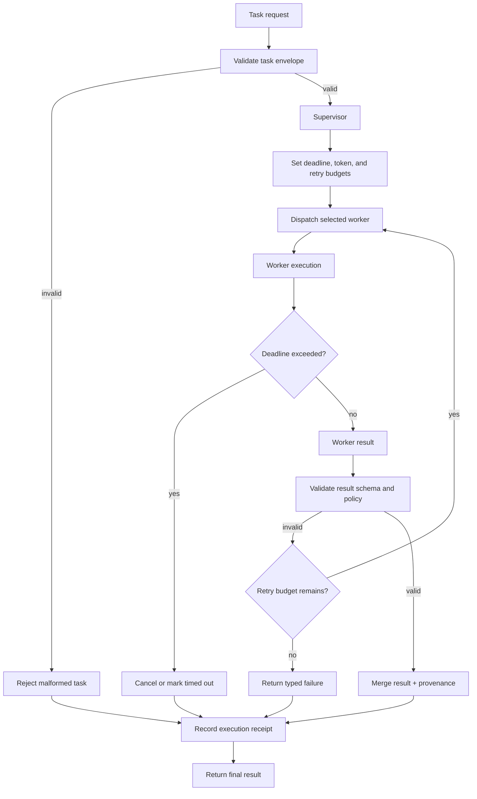

# x4-harness

**Multi-agent harness for coordinating coding agents** (Claude Code, Codex, Pi, and others) with shared context, role assignment, and adaptive memory.

Part of the X4 / ARIEX4Ops ecosystem — local-first, evidence-first.

## Why

Modern agent fleets need a thin, reliable coordination layer that:

- assigns roles (planner, implementer, reviewer, security)
- shares a single source of truth for context
- recovers when a specialist fails
- records evidence of every hand-off

## Quick Start

```bash
pip install -e ".[dev]"
python -m x4_harness.cli init my-team
```

## Core Concepts

| Concept | Description |
|---------|-------------|
| Team | Named group of agent slots |
| Role | Capability contract (tools + system prompt + limits) |
| Shared Memory | Ephemeral + persistent store visible to all members |
| Handoff | Evidence-backed transfer of ownership |

## License

Apache-2.0

## APEX Architecture Map

> Status: architecture documentation; implementation and deployment claims require independent verification.


**Evidence note:** Real cancellation, bounded retries, and worker isolation must be demonstrated by tests; a timeout label alone does not stop execution.

